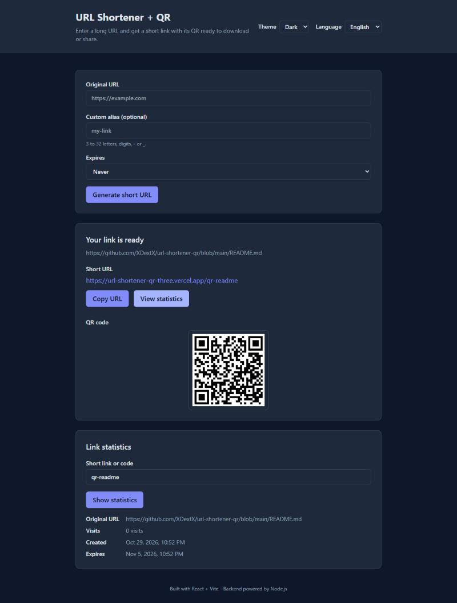

# URL Shortener with QR codes

A full-stack URL shortener: paste a long URL, get a short link and a QR code
ready to download or share. A layered Express API with a pluggable database
driver behind a React + Vite client, deployed as one Vercel project on
Postgres.

**Live demo:** https://url-shortener-qr-three.vercel.app



## Overview

- Shortens any `http` or `https` URL to an 8-character code, or to an alias
  the visitor chooses.
- Generates a QR code for every short link.
- Returns the existing code when the same URL is shortened twice.
- Lets a link expire after 1 hour, 1 day, 7 days or 30 days.
- Counts every redirect as a hit, and shows each link's visits and creation
  date on the page.
- Limits link creation per client, so no one can flood the database.
- English and Spanish interface, light and dark theme.
- No sign-up: open the page and use it.

## Architecture

An npm workspaces monorepo with three packages:

```
apps/backend        Express API (TypeScript)
apps/frontend       React + Vite client, i18next, Tailwind
packages/database   data access behind a driver registry
api/index.ts        the Vercel function that serves the API
```

The backend is layered, and each layer only calls the one below it:
routes → controllers → services → repositories → `@url-shortener/database`.
Only the database package talks to a database driver.

The database package exposes one `DatabaseDriver` contract and picks the
implementation from `DATABASE_DRIVER`:

- `sqlite` (default): sql.js, for local development and tests. No server needed.
- `postgres`: Prisma over Postgres, used in production on Neon. The schema
  lives in `packages/database/prisma/schema.prisma` and changes only through
  migrations.

Both drivers pass the same contract test suite.

In production the whole app runs on one Vercel origin: the static frontend
answers `/` and its assets, and every other path is rewritten to the Express
function, so the client calls the API on its own origin.

## API

All responses are JSON unless noted. Examples use the live demo.

**POST** `/api/v1/urls`

Shortens a URL. Shortening a URL that already exists returns its existing code.
An optional `alias` (3 to 32 letters, digits, `-` or `_`) becomes the code
instead of a random one; `api`, `health` and `assets` are reserved. An
optional `expiresIn` (`1h`, `1d`, `7d` or `30d`) makes the link stop
redirecting after that time; shortening an expired link's URL again renews it
with the same code, while a live link keeps its expiry.

```bash
curl -X POST https://url-shortener-qr-three.vercel.app/api/v1/urls \
  -H "Content-Type: application/json" \
  -d '{"originalUrl":"https://example.com/a/long/path","alias":"my-path"}'
```

```json
{
  "code": "my-path",
  "shortUrl": "https://url-shortener-qr-three.vercel.app/my-path",
  "originalUrl": "https://example.com/a/long/path",
  "qrCodeDataUrl": "data:image/png;base64,...",
  "hits": 0,
  "createdAt": "2026-10-29T12:00:00.000Z",
  "expiresAt": null
}
```

- `201` the short link was created or already existed.
- `400` the URL is missing, longer than 2048 characters, malformed, or not
  `http`/`https`, or the alias or `expiresIn` breaks its rule; the body
  carries a `message`.
- `409` the alias is taken, or the URL already has a short link under another
  code, which the `message` names.
- `429` this client created too many links this minute (10 by default); the
  `Retry-After` header says how many seconds to wait. Clients are counted by a
  hash of their IP, so no address is stored.
- `500` the store failed; the body carries only a generic `message`.

**GET** `/api/v1/urls/:code`

Returns the same fields as above for an existing code, `hits` being how many
times the link was opened. Lookups are not counted as hits.

- `200` found.
- `404` no short link has that code.
- `500` the store failed.

**GET** `/:code`

Redirects to the original URL and counts a hit.

- `302` redirect to the original URL.
- `404` no short link has that code (plain text).
- `410` the link has expired; no hit is counted (plain text).
- `500` the store failed (plain text).

**GET** `/health`

- `200` `{"status":"ok"}`.

**GET** `/`

When the API runs on its own, redirects (`302`) to `FRONTEND_URL`. On Vercel
the static frontend answers `/` first.

## Running locally

Requirements: Node.js 20 or later, npm 10 or later.

```bash
git clone https://github.com/XDextX/url-shortener-qr.git
cd url-shortener-qr
npm install
cp apps/backend/.env.example apps/backend/.env
cp apps/frontend/.env.example apps/frontend/.env
npm run dev
```

The API listens on http://localhost:3000 and the client on
http://localhost:5173. Locally the store is SQLite, so no database server is
needed.

The variables that matter, in the backend's `.env` file:

- `PORT`: the API's port, `3000` by default.
- `BASE_URL`: the origin short links are built on; locally
  `http://localhost:3000`.
- `FRONTEND_URL`: where `GET /` redirects and the origin CORS allows.
- `DATABASE_DRIVER` and `DATABASE_URL`: `sqlite` and a `file:` path by
  default; `postgres` and a connection string for Postgres.
- `RATE_LIMIT_MAX`: links one client may create per minute, `10` by default.

## Testing

```bash
npm test
npm run build
```

`npm test` runs every workspace's suite with Vitest; `npm run build` compiles
every workspace. Both must pass for a change to count as done, and CI runs them
with the linter on every push and pull request to `main`.

The database contract suite always runs against SQLite in memory. To run it
against Postgres too, set `TEST_DATABASE_URL` to a disposable database, such as
a Neon development branch: the suite empties the table it tests.

## Deploying

The whole app runs on one Vercel project: the frontend is served as static
files, and `api/index.ts` runs the Express backend as a function. Links are
stored in Postgres (Neon) through Prisma.

1. In Vercel, **Add New → Project** and import this repository. Leave the
   framework preset as **Other**: `vercel.json` sets the build command and the
   output directory.
2. In the project, **Storage → Neon → Create**, and connect it to every
   environment. Neon adds `DATABASE_URL` (pooled) and `DATABASE_URL_UNPOOLED`
   (direct, used by migrations).
3. In **Settings → Environment Variables**, add `DATABASE_DRIVER=postgres`.
   Nothing else is required: short links are built on `BASE_URL` if set, else
   on the production domain Vercel provides.
4. Push to `main`. The build runs `npm run build` and then `npm run db:deploy`
   (`prisma migrate deploy`), so a failed migration fails the deploy before it
   reaches visitors.

Preview deployments share the production database.

## Roadmap

- QR codes downloadable as SVG as well as PNG.
- Accounts, so a visitor can list and manage their own links.
- Custom domains for short links.

## License and contact

Released under the [MIT licence](LICENSE).

- Issues: https://github.com/XDextX/url-shortener-qr/issues
- Email: germonram@gmail.com
